# ⌘ Claude Panel

**See exactly what Claude Code sends the model, manage everything in your `~/.claude`, and take it with you through Feishu.**

A local dashboard for Claude Code with a zero-dependency core: browse and edit slash commands, skills, agents, plugins and workflows; search and replay past sessions; track token spend; and, uniquely, **capture the real system prompt, tool definitions and every LLM round-trip** behind each conversation. It also routes across multiple accounts with automatic failover, and lets you continue local Claude Code sessions from your phone through a **Feishu (Lark) bot**.

```bash
npx claude-code-panel
```

[中文文档](README.md) · [Quick Start](#quick-start) · [Features](#features) · [Feishu gateway](#feishu-gateway) · [Account routing](#account-routing) · [Screenshots](#screenshots) · [Changelog](#changelog)

   

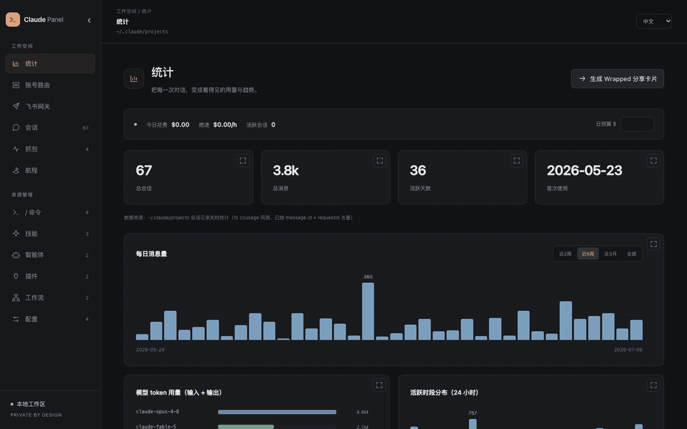

## Why

Claude Code scatters everything across `~/.claude`: commands here, skills there, plugins in a JSON manifest, usage buried in hundreds of MB of transcript JSONL. And the most interesting thing of all, *what actually gets sent to the model*, isn't saved anywhere. Claude Panel fixes that:

- **Find** any command, skill, plugin or past session in one searchable place, editable in the browser.
- **Recover** the session you lost after a crash or reboot: full-text search your history, one-click `claude --resume`.
- **Understand** how a reply was produced: the exact **system prompt**, **tool definitions**, **full context**, and the **input/output of every LLM round** a query triggered.
- **Step away**: message a Feishu bot to view, switch and continue the sessions running on your Mac.

## The killer feature: see every LLM round-trip

Claude Code transcripts don't store the system prompt or the raw request/response. Claude Panel runs a tiny **local reverse proxy** that Claude Code talks through, records each API call, and folds it back into the session replay, matched to the exact turn.

Open a session, expand a query, and you get **"🔁 This query triggered N LLM rounds"**. Expand any round to see the **full context sent to the model** (every message, tool call and tool result), the **system prompt**, the **tool definitions with full descriptions**, the **thinking** and the **response**, plus token usage.

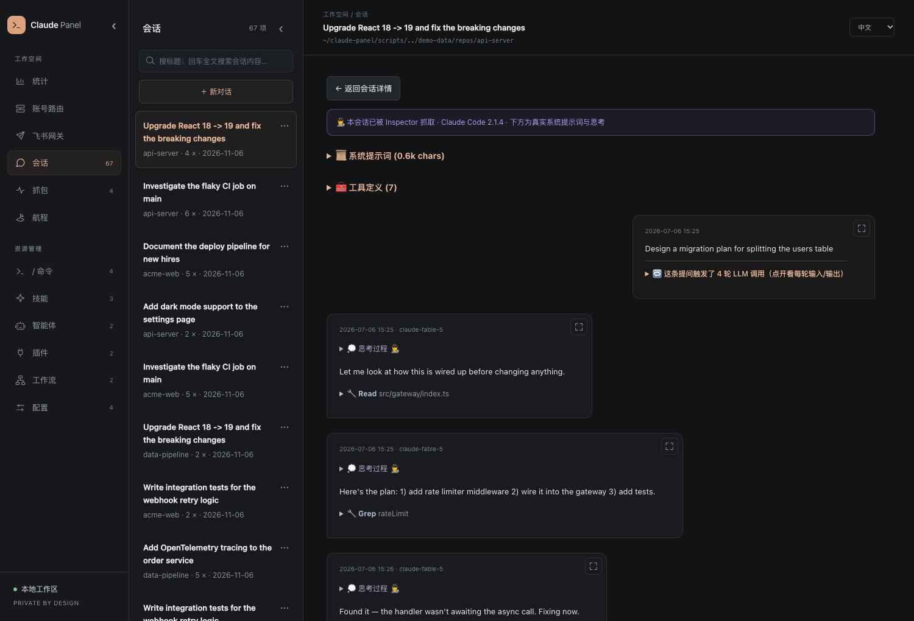

Set it up once: on first run the panel adds a `claude` wrapper to your shell (routes through the proxy while the panel is up, connects directly when it's off). Credentials are never written to captures; all data stays local.

## 🚢 Your sessions are a voyage

Hundreds of sessions aren't a mess; they're the log of your work. The **Voyage** tab renders them as one continuous timeline: a river colored by project (block = session, height = conversation turns), split into storyline "legs", each labeled by the intent you opened it with. Computed locally from `history.jsonl`.

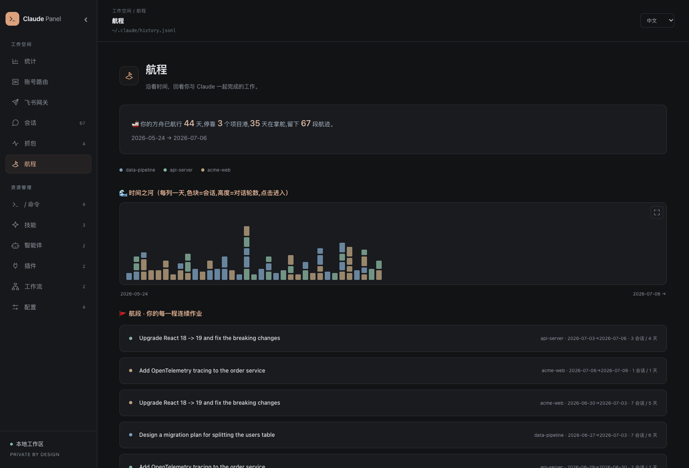

## Features

| Section | What you get |
|---|---|
| **/ Commands** | Your commands, plugin-provided ones and Claude Code built-ins in one searchable list with usage counts. Full CRUD on yours; built-ins read-only |
| **Skills / Agents / Workflows** | Browse and edit, frontmatter as chips, Markdown rendered. Marketplace-installed items are detected and protected from accidental edits |
| **Plugins** | Installed plugins with version, marketplace and everything they provide; one-click uninstall |
| **Config** | `CLAUDE.md`, `settings.json` and keybindings edited in place (JSON validated before save), plus a merged CLAUDE.md view |
| **Sessions** | Every session that still has a transcript: full-text search, chat-style **replay**, one-click `claude --resume`, and continuing the conversation right in the browser |
| **🕵️ Inspector** | Local reverse proxy capturing live traffic: system prompt, tool definitions, full context, streamed response including thinking, Claude Code version. Persisted to disk and folded into replays |
| **Stats** | `ccusage`-accurate usage: daily messages, per-model tokens, 24h heatline, `ccusage daily`-style cost table, and a live ticker (today's spend, burn rate, budget alerts) |
| **Account routing** | One-click import of your current Claude config, paste-to-add env, manual switching, automatic failover, round robin, model mappings and extra env variables |
| **💬 Feishu gateway** | A Feishu bot connected to your Mac over a long connection: view, switch, create and continue sessions; images; queueing and mid-turn steering; separate bindings per private chat, group and topic; access control and a local message log; Mac keep-awake and login startup |
| **🚢 Voyage** | Your scattered sessions rewoven into one timeline, colored by project and split into intent-labeled legs |
| **🎁 Wrapped** | One-click shareable PNG card: spend, tokens, top command, favorite model and an earned badge |

Cross-cutting:

- 🌏 **Full i18n**: 中文 / English / 日本語, switchable live (UI, backend and generated content).
- 📁 **Project scope**: a dropdown scopes Commands / Skills / Agents / Workflows / Config to any project's `.claude/` directory.
- 🎯 **Accurate stats**: recursive transcript scan, `message.id + requestId` dedup, streaming-final handling, 5m/1h cache-tier pricing. Validated day by day against ccusage.
- 🔒 **Local only**: binds to `127.0.0.1`, path-traversal guarded, credentials excluded from captures, sensitive config files stored with mode `0600`.
- ⚡ **Zero-dependency core**: no build step, ~0.8s cold scan of 300MB of transcripts (~13ms warm). Only the Feishu gateway needs an optional SDK.

## Quick Start

Requires Node.js ≥ 18.

```bash
npx claude-code-panel
# open http://localhost:4321
```

On first run it adds a `claude` wrapper to your shells so future sessions are captured automatically. **Open a new terminal** (or `source ~/.zshrc`) and use `claude` as usual; with the panel running, that session's full trace shows up under Sessions. Opt out with `CCP_NO_PROXY_SETUP=1`; remove it with `npx claude-code-panel uninstall-proxy`.

From source:

```bash
git clone https://github.com/13days/claude-panel.git
cd claude-panel
npm install        # only needed for the Feishu gateway; skip it or use npm install --omit=optional
node server.js
```

| Variable | Default | Purpose |
|---|---|---|
| `PORT` | `4321` | Panel port |
| `PROXY_PORT` | `PORT+1` | Capture / account-routing proxy port |
| `CLAUDE_DIR` | `~/.claude` | Claude config directory; the panel stores its own data here too |
| `CCP_NO_PROXY_SETUP` | — | Set to `1` to skip shell setup |

### Terminal statusline

Show today's spend at the bottom of your Claude Code terminal. Add to `~/.claude/settings.json`:

```json
{ "statusLine": { "type": "command", "command": "curl -s http://localhost:4321/api/statusline" } }
```

→ `$23.40 today · 40.6M tok · fable-5`

### Try it with demo data

```bash
python3 scripts/gen-demo-data.py
CLAUDE_DIR="$PWD/demo-data/claude" PORT=4999 node server.js
```

## Feishu gateway

Message a Feishu bot privately to drive Claude Code on your Mac.

```
Feishu app ──official long connection──▶ Claude Panel on your Mac ──▶ local Claude Code CLI
                                          (same processes, account routing and session records)
```

- **No public endpoint**: the bot receives messages over the official SDK's WebSocket long connection. No public IP, port forwarding or cloud storage.
- **Same sessions as the web UI**: tasks started from Feishu share Claude Code processes, account routing and local session records with the browser, so you can switch between them at any time.
- **Live task cards**: text, tool inputs and results refresh about every 1.2 seconds; the final content is filled in on completion and long replies are split.

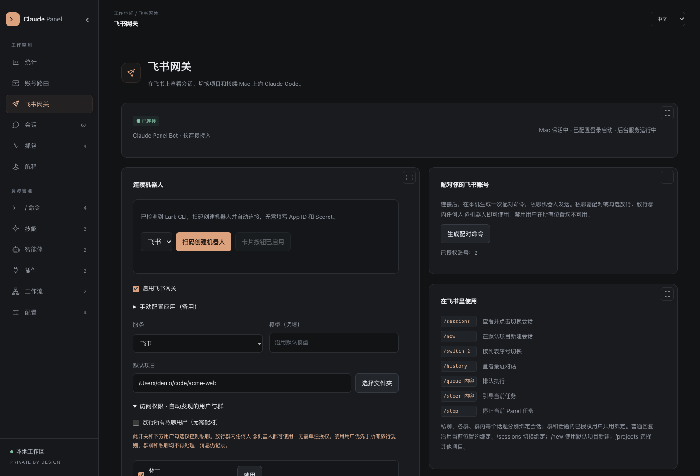

### Setup

1. **Create the bot**: open **Feishu gateway** in the sidebar.
   - With `lark-cli` installed, click **Create bot with QR code**. After scanning, the app is created, its credentials are saved and it connects. The panel uses its own CLI config directory and leaves your existing CLI accounts alone.
   - Without the CLI, expand **Manual app setup (fallback)**: create a **custom enterprise app** on the [Feishu open platform](https://open.feishu.cn/app), enable the bot capability, and enter the App ID and App Secret in the panel. Group "custom webhook bots" won't work.
2. **Permissions and events**: confirm the following in the app console (QR creation configures the card callback automatically; check the rest manually):

   | Item | Value | Purpose |
   |---|---|---|
   | Permission | `im:message:send_as_bot` | Send messages and cards |
   | Permission | `im:message.p2p_msg:readonly` | Receive private messages |
   | Permission (optional) | `im:message.group_at_msg:readonly` | Receive @bot messages in groups |
   | Permission (optional) | `im:message.reactions:write_only` | "Typing" reaction in simple mode |
   | Permission (optional) | Message resource read | Receive images |
   | Event subscription | Long connection · `im.message.receive_v1` | Receive messages |
   | Callback subscription | Long connection · `card.action.trigger` | Card buttons; text commands work without it |

3. **Publish and enable**: publish an app version and make sure its availability includes you. Back in the panel, choose a default project, check **Enable** and save. The page shows the connection state or the exact error.
4. **Pair**: generate a pairing command in the panel and send `/pair <code>` to the bot **in a private chat**. Codes are valid for 10 minutes and single-use. By default only paired accounts can operate the bot.

### Using it in Feishu

Send text or images and they go to the session bound to the current chat. Sending again while a task is running steers that task.

| Command | Action |
|---|---|
| `/sessions [keyword]` | Paginated session list (5 per page) with the current session and run state marked; tap a card to switch |
| `/switch 2` | Switch by number from the last list; a unique ID prefix or full name also works |
| `/new`, `/new 1`, `/projects` | New session in the default project; `/projects` lists projects, `/new <n>` or a known path picks one |
| `/current` | Show the bound session |
| `/history` | Last 10 messages |
| `/queue <text>` | Queue it to run after the current turn |
| `/steer <text>` | Interrupt the current turn and continue with the extra instructions |
| `/rename <name>` | Pin a session name, shared by web and Feishu |
| `/stop`, `/status`, `/help` | Stop a task started by this panel, show status, list commands |
| `/ask /command` | Forward a Claude slash command as text so it doesn't collide with gateway commands |

**Session bindings**: each private chat, group and topic is bound to its own session, persisted across restarts. The first message from a new location creates a dedicated session in the default project. Authorized users in the same group or topic share its binding; replying to an old card doesn't change a binding you've since switched. Sessions currently running in an external terminal can be viewed, and can be continued from Feishu once that turn ends.

**Tool permissions**: Claude Code runs started from the web UI and Feishu use `--dangerously-skip-permissions`; if the CLI still asks for tool approval, the panel approves it automatically. Cards show the tool calls that actually ran.

### Access control

| Setting | Default | Meaning |
|---|---|---|
| Paired / selected users | — | Private chats are open only to paired users or users checked in the list |
| Selected groups | — | Any member can @mention the bot; members don't need individual approval |
| Allow all users | Off | **Anyone who can message the bot privately** can continue sessions and run tasks on your Mac. Use with care |
| Allow all groups | Off | Skips per-group selection; an @mention is still required |
| Disabled users | — | Highest priority, overrides every allow rule: private messages, group messages, card buttons and extra deliveries are all blocked |

- Users and groups that have messaged the bot appear in the list automatically; just check them, no ID copying. Users also show their @mention count.
- Checkboxes save immediately and apply to new messages without interrupting running tasks; previously blocked messages are not replayed.
- Every received message (including blocked ones) is logged locally and can be browsed in the panel with user and group filters. Only messages delivered after the gateway comes online are recorded; earlier chat history is not fetched.

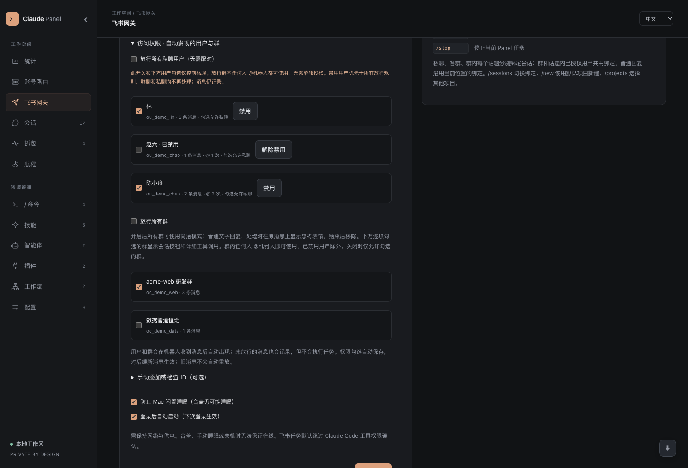

### Two display modes

| | Full mode | Simple mode |
|---|---|---|
| Applies to | Private chats, individually selected groups | Groups admitted only through "Allow all groups" |
| Reply | Task card: progress, tool arguments and results (collapsed), session info, management buttons | A single plain Markdown text reply with the final answer |
| While working | Card refreshes live, with a stop button | A "Typing" reaction on the original message, removed when done |
| Management | Everything available | No paths, session IDs or management controls |

With "Allow all groups" on, you can still check individual groups to give them full mode. Text replies use Feishu `post` rich text with `md` elements, so bold, lists, links and code blocks render properly; long messages keep their topic target when split and close any code fence that was cut.

### Letting Claude send cards

Each Feishu turn carries the current bot, chat and topic. When you ask Claude to "send a card" or "send it to me" without naming someone else, it sends a JSON 2.0 card or text back to the **original location** through the local `/api/feishu/reply` endpoint.

- The destination is fixed by a per-turn token; Claude can't redirect it to someone else or guess recipients from history.
- Access is rechecked on every send, and tokens expire after 2 hours.
- This context stays in the raw CLI records and captures only; it's hidden from the user text shown in the panel and in `/history`.

### Connection and uptime

- **Keepalive**: the SDK sends heartbeats at the server-provided interval (about 2 minutes by default). The panel also enables a 20-second pong timeout, so a dead connection is closed and reconnected automatically with unlimited retries. The panel shows the real connection state.
- **Keep Mac awake**: uses `caffeinate` to prevent idle sleep only while the panel process is alive. The screen can still turn off and system settings are untouched.
- **Start at login**: writes `~/Library/LaunchAgents/io.claude-panel.gateway.plist`, **effective at next login**, with logs in `~/.claude/panel-service.log`. Keep the source directory in place. Unchecking deletes the file; an already-loaded service stops at the next login.

To switch to the background service right away (stop any manual instance on the same port first):

```bash
launchctl bootstrap gui/$(id -u) ~/Library/LaunchAgents/io.claude-panel.gateway.plist
launchctl print gui/$(id -u)/io.claude-panel.gateway   # should report running
```

**Limits**: the Mac must stay powered, online and logged in; closing the lid, forced sleep or shutdown takes the bot offline. A panel restart doesn't resume interrupted CLI processes; send a new message in the same session to continue. Closing the browser doesn't affect tasks; disabling the gateway only disconnects Feishu and doesn't stop tasks already started.

### Data and privacy

| File (all under `CLAUDE_DIR`) | Contents | Mode |
|---|---|---|
| `panel-feishu.json` | Gateway config, App Secret, access rules | `0600` |
| `panel-feishu-state.json` | Session bindings, card mappings, dedup records | — |
| `panel-feishu-inbox.jsonl` | All received messages | `0600` |
| `panel-feishu-contacts.json` | Cached group names | — |

The status API never returns the secret. Messages, replies and any tool results you ask to see travel through Feishu; Claude's session records themselves stay on your Mac.

## Account routing

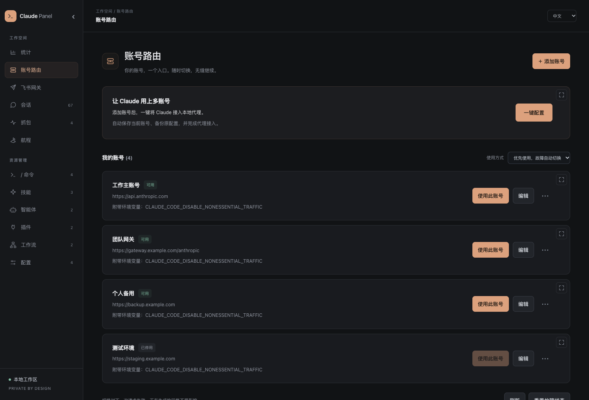

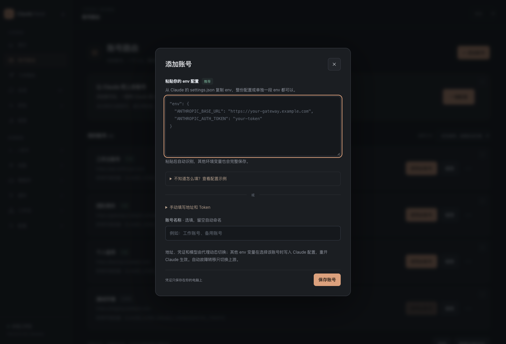

Add multiple env profiles under **Account routing**. Claude Code always talks to the local proxy, which picks an account per request. Supports manual switching, ordered failover, round robin, cooldowns and per-account model mappings; captures show which account served each request.

1. **One-click setup**: imports the account in Claude's current `settings.json`, backs up the file and points Claude at the local proxy; no account needs to be added first. Repeating it doesn't duplicate accounts or backups.
2. **Add an account**: paste env and it's parsed automatically. Full settings.json, `{"env":{...}}`, `"env": {...},` fragments and bare env objects are supported. Expand **See an example** to fill one in, or enter the URL and token manually; the name is optional. Auth type and model mappings are under advanced settings.
3. **Switch**: click **Use this account** on a card, or choose automatic failover / round robin. **More** lets you disable, delete or reorder accounts. Claude's base URL is `http://127.0.0.1:4322` (default port); real credentials are injected by the proxy.
4. **Restart Claude once after setup.** If your shell exports `ANTHROPIC_BASE_URL` / `ANTHROPIC_AUTH_TOKEN` / `ANTHROPIC_API_KEY`, `unset` them, and don't override the local URL in project settings or launch flags. Later switches apply from the next request without restarting; streams already in progress stay on their original account.

**Failover**: 401 / 402 / 403 / 429, 500 / 502 / 503 / 504 / 529 or connection errors move to the next available account. Default cooldowns: 300s for auth errors, 60s for exhausted credits or rate limits, 15s for server errors, honoring upstream `Retry-After` (up to a day). If every account is cooling down the proxy returns 503; clear cooldowns in the panel or select an account manually. Other request errors are returned as-is, and streams are never replayed once started. Providers may differ in how they handle existing thinking signatures; the proxy keeps messages intact and never trims context.

**Model mappings**: JSON such as `{"opus":"your-opus-id","sonnet":"your-sonnet-id"}` or `{"*":"fixed-model-id"}`. Bearer and x-api-key credentials are supported. "Pass through client credentials" only works when the client holds real credentials; it can't be combined with the local placeholder token and doesn't emulate OAuth login or refresh.

**Full env**: each account keeps its complete env, including empty strings and extra variables (e.g. `CLAUDE_CODE_ENABLE_GATEWAY_MODEL_DISCOVERY`). URL, credentials and model are switched per request by the proxy; when you select an account manually, its other env variables are written to Claude's settings.json and you're prompted to restart Claude. Switching away restores previous values or removes variables the account added. Failover and round robin switch upstreams only; client env stays on the selected account. APIs return variable names only, never env values or credentials.

**Storage and opting out**: accounts are stored in `CLAUDE_DIR/panel-proxy.json` (mode `600`, plaintext on this machine; keep it safe). Upstream tokens never appear in API responses or captured request headers. The pre-setup backup is `settings.json.proxy-backup-*` in the same directory; to leave local routing, merge the original env from it back into `settings.json` and restart Claude. **Keep the panel running while using account routing**; Claude won't fall back to direct connections when it's closed.

## Screenshots

**Usage dashboard**: live spend ticker, daily volume, per-model tokens, `ccusage daily`-style cost table

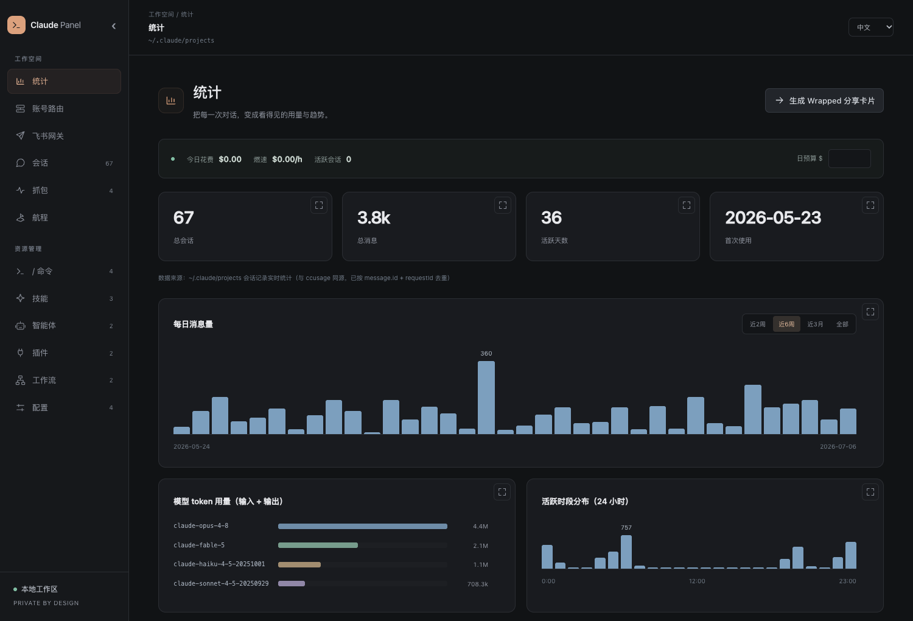

**Chat in the browser**: open a session and keep going, with collapsible tool calls and image paste

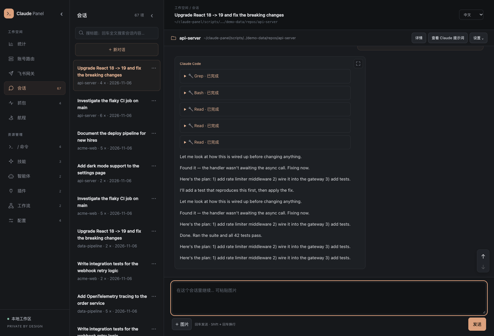

**Inspector**: the real system prompt, tool definitions and response Claude Code never saves

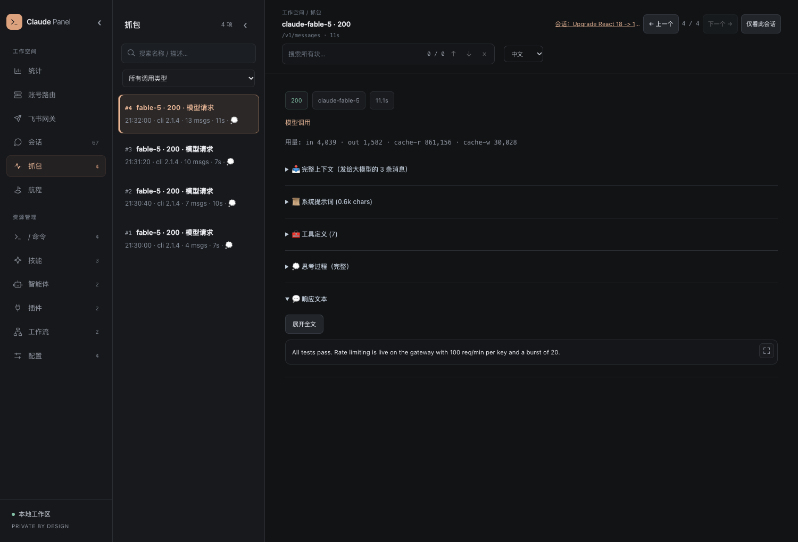

**Every command in one place**: yours, your plugins' and Claude Code's built-ins, with usage counts

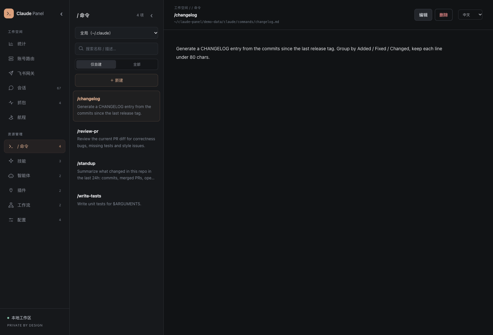

**Skills, rendered properly** · **🎁 Wrapped card** · **Speaks your language**

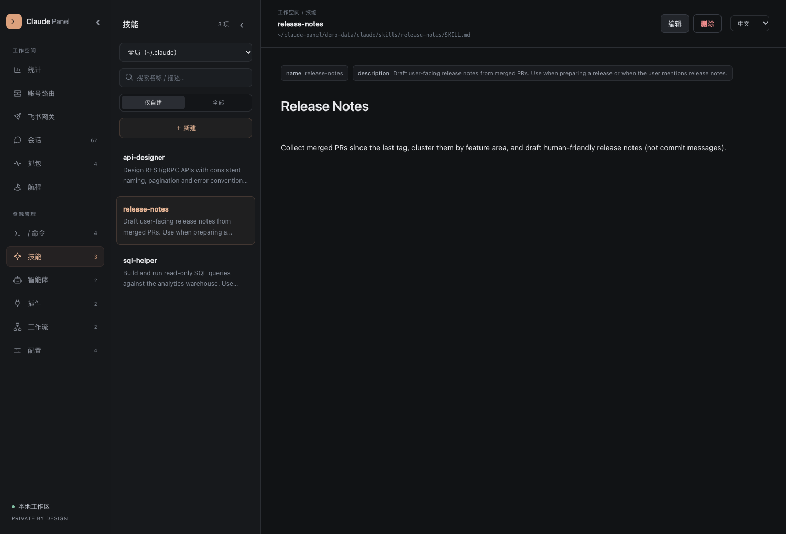 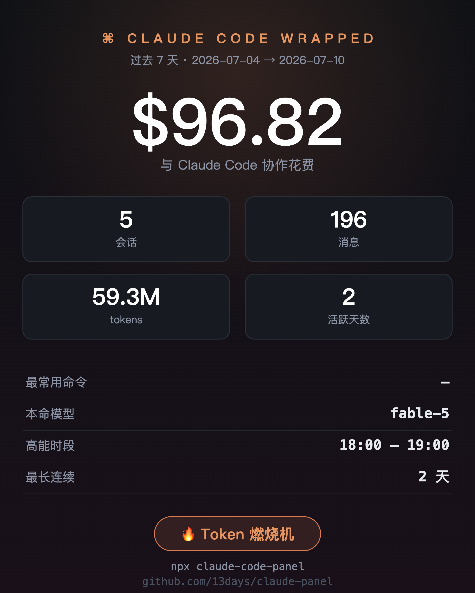

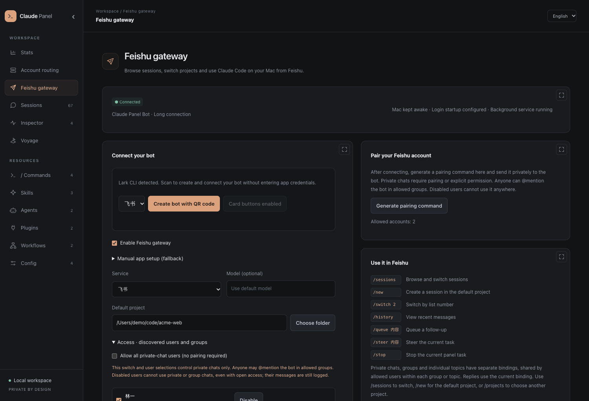

## How it works

No framework, no build step; the backend is split into small modules:

| File | Responsibility |
|---|---|
| `server.js` | Node HTTP server: REST API over `CLAUDE_DIR` (guarded writes), usage aggregation (mtime cache), capture proxy on `PROXY_PORT` |
| `proxy-router.js` | Multi-account persistence, dynamic routing, model mapping, failover and streaming |
| `capture-store.js` | Capture persistence and search |
| `session-store.js`, `chat-session.js`, `chat-job.js`, `chat-input.js` | Session index and titles, CLI job scheduling shared by web and Feishu, follow-up input and queueing |
| `chat-permissions.js`, `cli-result.js`, `model-defaults.js` | Tool approval bridge, CLI result parsing, default models |
| `feishu-gateway.js` | Feishu long connection, command routing, session bindings and access control |
| `feishu-cards.js`, `feishu-markdown.js`, `feishu-simple-reply.js` | JSON 2.0 cards, Markdown rich-text chunking, simple-mode replies |
| `feishu-inbox.js`, `feishu-ui.js`, `lark-setup.js` | Message log, gateway settings page, QR bot creation |
| `mac-runtime.js`, `folder-picker.js` | Mac keep-awake / login startup, project folder picker |
| `index.html`, `panel.css` | Single-page app (with a mini Markdown renderer) and the shared design system / responsive layout |

### Adding a language

1. Register it in `LANGS` (`index.html`); it shows up in the dropdown.
2. Add a dictionary to `I18N` (`index.html`) and `STRINGS` (`server.js`).

Partial translations are fine; missing keys fall back `your language → English → default`.

## Development

```bash
npm test
```

Tests never call a real model API or Feishu. A local mock upstream covers account switching, streaming, failover, credential redaction, one-click setup and env save/restore; simulated Feishu events against the real panel HTTP API cover commands, session bindings, access control, card replies, Markdown chunking and CLI follow-up input. You'll still want one private-chat check with your own app the first time you use Feishu.

## Caveats

- Costs are estimates from official per-model pricing (validated against ccusage; your bill may differ).
- Claude Code keeps transcripts for about 30 days; the system prompt / LLM trace only exists for sessions **captured live through the proxy**. Historical ones can't be recovered.
- The built-in command list is a static snapshot (PRs welcome).
- The Feishu gateway depends on your Mac being online; see [Connection and uptime](#connection-and-uptime).

## Changelog

### 0.16.0 Feishu gateway

- New Feishu gateway: official SDK long connection, QR bot creation, pairing; view, switch, create and continue local sessions from Feishu, with images, `/queue` and `/steer`.
- Separate session bindings per private chat, group and topic; live JSON 2.0 task cards with collapsible tool details.
- Access control: automatic discovery of users and groups, checkbox allow lists, allow-all switches, disabled users; every received message logged locally.
- Simple mode: groups admitted through allow-all get plain Markdown replies and a "Typing" reaction while working.
- Claude can send cards or text back to the current location through a local endpoint, with the destination fixed by a per-turn token.
- Mac keep-awake and login startup; 20-second heartbeat timeout and automatic reconnects for the long connection.
- Continue sessions directly in the browser, sharing the same job scheduler as Feishu.
- The core is still dependency-free; the Feishu SDK is optional.

### 0.15.1 Interface refresh

A consistent visual system across all sections: grouped navigation, a separate resource library, full-width overview pages, shared card, chart, code and dialog styling, and a mobile resource drawer. The panel opens on the usage overview and remembers your last section. Fixes stale content after navigation, late responses overwriting another section, Voyage language switching, and navigating away from unsaved edits. See the [UI review](docs/ui-review.md).

### 0.15.0 Account routing

- Multi-account dynamic routing: manual switching, automatic failover, round robin and per-account model mappings.
- One-click import of the current Claude account, settings.json backup and local proxy setup.
- Paste-env as the primary way to add accounts, with automatic parsing and examples; manual entry as a fallback.
- Full env saved per account; extra variables applied on selection with a restart prompt, restored when switching away.
- Captures show which account served each request.
- Chinese became the default README; English lives in this file.

## License

[MIT](LICENSE)

---

*Built with [Claude Code](https://claude.com/claude-code), for Claude Code.*
