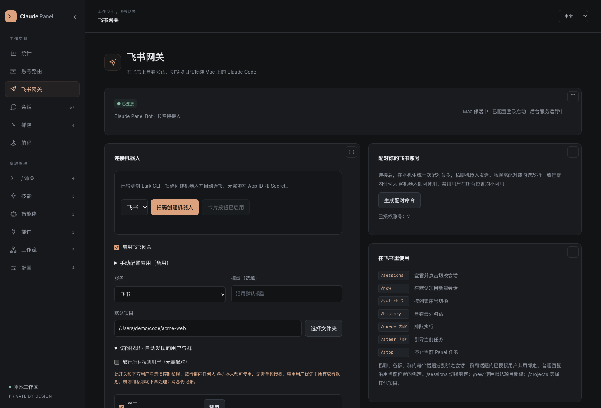
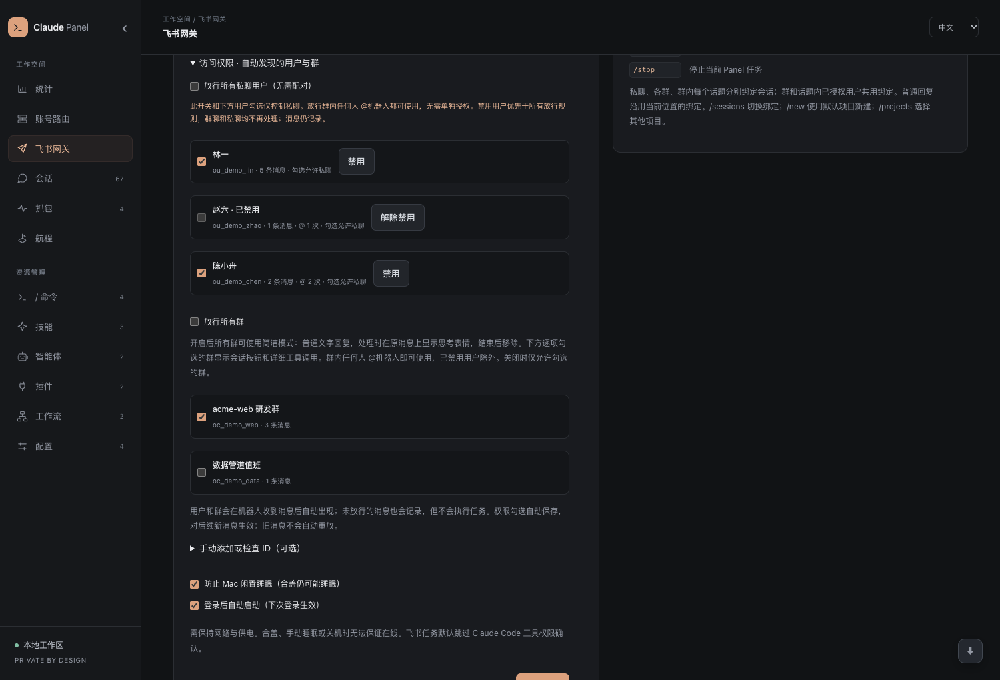
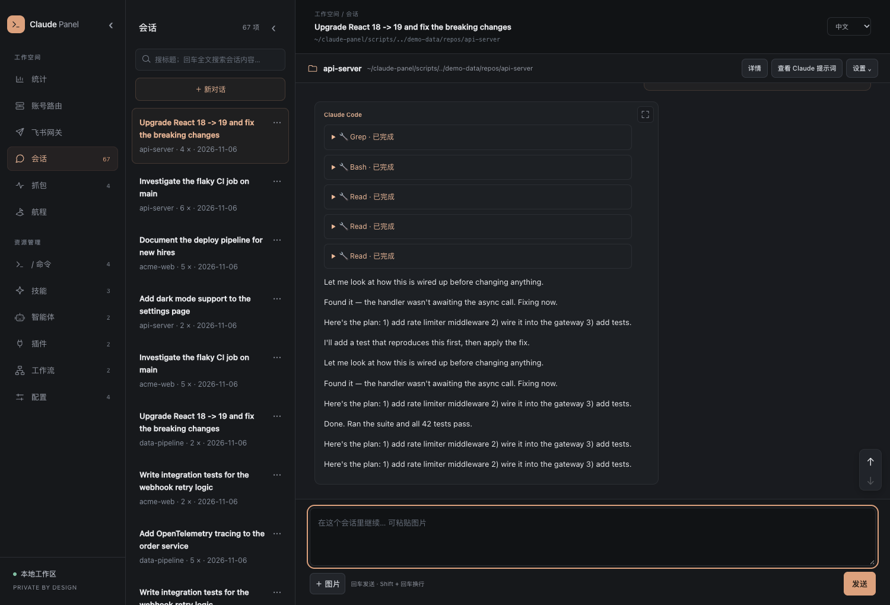

# ⌘ Claude Panel

**看清 Claude Code 到底给大模型发了什么——管好 `~/.claude` 里的一切——再用飞书把它带出门。**

Claude Code 的本地可视化面板，核心零依赖：浏览/编辑斜杠命令、技能、智能体、插件、工作流，搜索并回放历史会话，统计 token 花费；独一份地**抓出每次对话背后真实的系统提示词、工具定义和每一轮 LLM 调用**。还能多账号路由自动切换，并通过**飞书机器人**在手机上继续本机的 Claude Code 会话。

```bash
npx claude-code-panel
```

[English](README.en.md) · [快速开始](#快速开始) · [功能](#功能) · [飞书网关](#飞书网关) · [多账号路由](#多账号动态路由) · [截图](#截图) · [更新日志](#更新日志)

   


## 为什么做这个

Claude Code 把东西散落在 `~/.claude` 各处——命令一处、技能一处、插件藏在 JSON 清单里、用量埋在几百 MB 的会话记录里。而最有价值的东西——**到底发给大模型了什么**——根本没存。Claude Panel 解决这些：

- **查得快**：命令 / 技能 / 插件 / 历史会话不用在命令行里翻，一屏可搜、可直接编辑。
- **找得回**：电脑卡死 / 重启后丢掉的会话，全文搜索历史内容，一键 `claude --resume`。
- **看得透**：一条回复是怎么来的——精确的**系统提示词**、**工具定义**、**完整上下文**，以及这条提问触发了**几轮 LLM 调用、每轮的输入和输出**。
- **离得开**：人不在电脑前，在飞书里私聊机器人，就能查看、切换、接续 Mac 上的会话。

## 杀手级功能：看到每一轮 LLM 调用

Claude Code 的会话记录里没有系统提示词，也没有原始请求/响应。Claude Panel 起了一层**本地代理**，让 CC 的流量从这里走，记录每次 API 调用，再按轮次精确折叠回会话回放里。

打开一个会话、展开某条提问，就会出现 **「🔁 这条提问触发了 N 轮 LLM 调用」**。展开任意一轮，能看到这一轮**发给大模型的完整上下文**（每条消息、工具调用、工具返回）、**系统提示词**、**工具定义（含完整描述）**、**思考过程**、**响应**，以及 token 用量。


一次配置即可：面板首次启动会把一个 `claude` 包装函数写进你的 shell（面板开着就走代理、关了自动直连，不影响正常使用）。凭证不会写入抓包记录，数据只保存在本机。

## 🚢 你的会话就是一段航程

几百个会话不是乱账，而是你工作的航海日志。**航程**专区把它们渲染成一条连续的时间线：按项目着色的时间之河（色块 = 会话，高度 = 对话轮数），以及一段段「航段」——每段连续作业都以你出发时的那句意图命名。全部本地计算，来自 `history.jsonl`。


## 功能

| 专区 | 内容 |
|---|---|
| **/ 命令** | 自建 + 插件提供 + CC 内置命令统一列表，带使用次数；自建可增删改，内置只读 |
| **技能 / 智能体 / 工作流** | 浏览编辑，frontmatter 变标签，Markdown 渲染；市场安装项自动识别、防误改 |
| **插件** | 已装插件的版本 / 市场 / 提供的能力，一键卸载 |
| **配置** | `CLAUDE.md`、`settings.json`、快捷键就地编辑（JSON 保存前校验），含 CLAUDE.md 合并视图 |
| **会话** | 全部仍有记录的会话：跨会话全文搜索、聊天式**回放**、一键 `claude --resume`，也可以直接在网页里继续对话 |
| **🕵️ 抓包 Inspector** | 本地代理实时抓取：系统提示词、工具定义、完整上下文、含思考的流式响应、CC 版本；持久化到本地，折叠进回放 |
| **统计** | 与 `ccusage` 对齐的用量：每日消息、模型 token、24h 热区、`ccusage daily` 同款费用表，以及实时条（今日花费 / 燃速 / 预算告警） |
| **多账号路由** | 一键接入当前 Claude 配置；粘贴 env 自动识别；手动切换、自动故障转移、轮询、模型映射和额外环境变量 |
| **💬 飞书网关** | 飞书机器人长连接到本机：查看 / 切换 / 新建 / 接续会话，图片消息，排队与中途引导，私聊、群、话题各自绑定；访问控制与消息留档；Mac 保活和登录自启 |
| **🚢 航程 Voyage** | 把散乱的会话重织成一条时间线，按项目着色，切分成以意图命名的「航段」 |
| **🎁 Wrapped** | 一键生成可分享 PNG 成绩单：花费、token、最爱命令、本命模型、专属称号 |

横向能力：

- 🌏 **完整多语言**：中文 / English / 日本語 实时切换（界面 + 后端 + 生成内容）
- 📁 **项目作用域**：下拉框把命令 / 技能 / 智能体 / 工作流 / 配置切到任意项目的 `.claude/`
- 🎯 **统计准确**：递归扫描、`message.id + requestId` 去重、流式取终值、区分 5m/1h 缓存价，与 ccusage 逐日校验一致
- 🔒 **只在本机**：仅监听 `127.0.0.1`，防目录穿越，凭证不写入抓包，敏感配置文件权限 `0600`
- ⚡ **核心零依赖**：无构建步骤，300MB 会话记录冷扫约 0.8s（热约 13ms）；只有飞书网关需要一个可选 SDK

## 快速开始

需要 Node.js ≥ 18。

```bash
npx claude-code-panel
# 打开 http://localhost:4321
```

首次运行会把 `claude` 包装函数写进你的 shell，之后的会话自动被抓取。**开一个新终端**（或 `source ~/.zshrc`），照常用 `claude`；面板开着时，那次会话的完整 trace 就会出现在「会话」里。不想自动接入设 `CCP_NO_PROXY_SETUP=1`；移除用 `npx claude-code-panel uninstall-proxy`。

从源码运行：

```bash
git clone https://github.com/13days/claude-panel.git
cd claude-panel
npm install        # 只有飞书网关需要；不用飞书可跳过，或 npm install --omit=optional
node server.js
```

| 环境变量 | 默认值 | 说明 |
|---|---|---|
| `PORT` | `4321` | 面板端口 |
| `PROXY_PORT` | `PORT+1` | 抓包 / 账号路由代理端口 |
| `CLAUDE_DIR` | `~/.claude` | Claude 配置目录，面板自己的数据也存这里 |
| `CCP_NO_PROXY_SETUP` | — | 设为 `1` 跳过 shell 接入 |

### 终端状态栏

让 CC 终端底部实时显示今日花费，在 `~/.claude/settings.json` 中加入：

```json
{ "statusLine": { "type": "command", "command": "curl -s http://localhost:4321/api/statusline" } }
```

→ `$23.40 today · 40.6M tok · fable-5`

### 用演示数据先玩玩

```bash
python3 scripts/gen-demo-data.py
CLAUDE_DIR="$PWD/demo-data/claude" PORT=4999 node server.js
```

## 飞书网关

在飞书里私聊机器人，就能操作 Mac 上的 Claude Code。

```
飞书 App ──官方长连接──▶ Mac 上的 Claude Panel ──▶ 本机 Claude Code CLI
                          （同一套进程、账号路由、会话记录）
```

- **不需要公网**：机器人通过飞书官方 SDK 的 WebSocket 长连接收消息，没有公网 IP、端口映射或云端存储。
- **和网页是同一个会话**：飞书发起的任务与网页共用 Claude Code 进程、账号路由和本地会话记录，两边随时切换着用。
- **任务卡片实时刷新**：文字、工具输入和结果约每 1.2 秒更新一次，完成后补齐最终内容，长回复分段发送。



### 配置步骤

1. **创建机器人**：打开侧栏「飞书网关」。
   - 装了 `lark-cli` 时，点「扫码创建机器人」，扫码后应用自动创建、凭证自动保存并连接。Panel 使用独立的 CLI 配置目录，不会覆盖你已有的 CLI 账号。
   - 没有 CLI 时，展开「手动配置应用（备用）」：在 [飞书开放平台](https://open.feishu.cn/app) 创建**企业自建应用**、开启机器人能力，把 App ID 和 App Secret 填进面板。群里的「自定义 Webhook 机器人」不能用。
2. **开权限和事件**：在开放平台的应用后台确认以下配置（扫码创建会自动配好卡片回调，其余需手动检查）：

   | 配置项 | 值 | 用途 |
   |---|---|---|
   | 权限 | `im:message:send_as_bot` | 发送消息和卡片 |
   | 权限 | `im:message.p2p_msg:readonly` | 接收私聊消息 |
   | 权限（可选） | `im:message.group_at_msg:readonly` | 接收群里 @机器人 的消息 |
   | 权限（可选） | `im:message.reactions:write_only` | 简洁模式下的「思考中」表情 |
   | 权限（可选） | 消息资源读取 | 接收图片 |
   | 事件订阅 | 长连接 · `im.message.receive_v1` | 收消息 |
   | 回调订阅 | 长连接 · `card.action.trigger` | 卡片按钮；没开时可以先用文字命令 |

3. **发布并启用**：发布应用版本、确认可用范围包含自己。回到面板选默认项目，勾选启用并保存，页面会显示连接状态或具体的错误原因。
4. **配对**：在面板生成配对命令，**私聊**机器人发送 `/pair 配对码`。配对码 10 分钟有效、只能用一次。默认只有配对过的账号可以操作。

### 飞书里怎么用

直接发文字或图片，就会发到当前位置绑定的会话。任务运行中再发消息，会引导当前任务。

| 命令 | 作用 |
|---|---|
| `/sessions [关键词]` | 分页列出会话（每页 5 个），标出当前会话和运行状态，点卡片切换 |
| `/switch 2` | 按上一次列表的序号切换；也可以用唯一 ID 前缀或完整名称 |
| `/new`、`/new 1`、`/projects` | 在默认项目新建会话；`/projects` 列出项目，`/new 序号` 或已知路径指定项目 |
| `/current` | 查看当前绑定的会话 |
| `/history` | 最近 10 条对话 |
| `/queue 内容` | 排队，当前这轮结束后再执行 |
| `/steer 内容` | 中断当前这轮，带着补充内容继续 |
| `/rename 名称` | 固定会话名称，网页与飞书共用 |
| `/stop`、`/status`、`/help` | 停止本 Panel 发起的任务、查看在线状态、查看命令 |
| `/ask /命令` | 把 Claude 的斜杠命令当正文转发，避免和网关命令冲突 |

**会话绑定**：私聊、每个群、每个话题各自绑定一个会话，重启后保留。新位置第一次发消息时，会在默认项目自动建一个独立会话。同一个群或话题里的授权用户共用这个绑定；回复旧卡片不会改掉已切换的绑定。在外部终端里正在跑的会话可以查看记录，要等那一轮结束才能从飞书续接。

**工具权限**：网页和飞书发起的 Claude Code 都带 `--dangerously-skip-permissions` 运行，CLI 如果仍请求工具确认，面板会自动允许。卡片里展示的是实际执行过的工具调用。

### 访问控制

| 设置 | 默认 | 说明 |
|---|---|---|
| 配对 / 勾选用户 | — | 私聊只对配对过或在列表里勾选的用户开放 |
| 勾选群 | — | 群内任意成员 @机器人 即可使用，不需要逐个授权成员 |
| 放行所有用户 | 关 | 开启后**任何能私聊机器人的人**都能接续会话、在你的 Mac 上执行任务，慎用 |
| 放行所有群 | 关 | 省去逐群勾选，仍然要求 @机器人 |
| 禁用用户 | — | 优先级最高，覆盖以上所有放行规则：私聊、群消息、卡片按钮、额外发送全部拦截 |

- 给机器人发过消息的用户和群会自动出现在列表里，直接勾选，不用复制 ID；用户还会显示 @ 次数。
- 勾选即自动保存，对之后的新消息立即生效，不会中断正在跑的任务；被拦下的旧消息不会补执行。
- 所有收到的消息（包括被拦截的）都留档在本地，面板里可按用户、群筛选分页查看。只记录上线后飞书推送过来的消息，不补采历史聊天。



### 两种显示模式

| | 完整模式 | 简洁模式 |
|---|---|---|
| 适用 | 私聊、单独勾选的群 | 只靠「放行所有群」接入的群 |
| 回复 | 任务卡片：进度、工具参数和结果（折叠）、会话信息、管理按钮 | 一条普通的 Markdown 文字回复 |
| 处理中 | 卡片实时刷新，带停止按钮 | 在原消息上挂「思考中」表情，结束后移除 |
| 管理命令 | 全部可用 | 不显示路径、会话 ID 和管理入口 |

开启「放行所有群」后，仍可以单独勾选某个群让它使用完整模式。文字回复统一用飞书 `post` 富文本的 `md` 元素发送：粗体、列表、链接、代码块都能正常显示，长消息分段时保留话题位置并补齐被切开的代码块。

### 让 Claude 主动发卡片

每一轮飞书任务都会附带当前的机器人、聊天和话题信息。你说「发张卡片」「发给我」而没有指定别人时，Claude 会通过本机的 `/api/feishu/reply` 接口把 JSON 2.0 卡片或文字发回**原位置**。

- 发送目标由这一轮的临时凭证固定，Claude 不能改发给别人，也不会从历史记录里猜收件人。
- 每次发送都重新检查访问权限，凭证 2 小时后过期。
- 这段上下文只保留在原始 CLI 记录和抓包里，不会显示在面板会话或 `/history` 的用户正文中。

### 连接与常驻

- **长连接保活**：SDK 按服务端下发的间隔（默认约 2 分钟）发送心跳；Panel 额外开启了 20 秒的心跳响应超时检测，连接假死时会主动断开并无限次自动重连。面板上显示的是真实连接状态。
- **保持 Mac 唤醒**：用 `caffeinate` 阻止系统空闲睡眠，只在 Panel 进程存活期间生效；屏幕仍可熄灭，不改系统设置。
- **登录后自动启动**：写入 `~/Library/LaunchAgents/io.claude-panel.gateway.plist`，**下次登录生效**，日志在 `~/.claude/panel-service.log`。源码目录需要保留。取消勾选会删除这个文件，已加载的服务到下次登录才停止。

想立刻改成后台运行（先停掉占用同一端口的手动实例）：

```bash
launchctl bootstrap gui/$(id -u) ~/Library/LaunchAgents/io.claude-panel.gateway.plist
launchctl print gui/$(id -u)/io.claude-panel.gateway   # 确认状态为 running
```

**限制**：Mac 需要保持供电、联网并处于登录状态，合盖、手动睡眠、关机都会让机器人离线。Panel 重启不会恢复已中断的 CLI 进程，在同一会话重新发消息即可接续。关闭网页不影响任务；禁用飞书网关只断开飞书，不会终止已经启动的任务。

### 数据与隐私

| 文件（都在 `CLAUDE_DIR` 下） | 内容 | 权限 |
|---|---|---|
| `panel-feishu.json` | 网关配置、App Secret、访问规则 | `0600` |
| `panel-feishu-state.json` | 会话绑定、卡片映射、去重记录 | — |
| `panel-feishu-inbox.jsonl` | 收到的全部消息 | `0600` |
| `panel-feishu-contacts.json` | 群名称缓存 | — |

状态接口不回传 Secret。消息、回复和你要求查看的工具结果会经过飞书传输，Claude 的会话记录本身只保存在 Mac 上。

## 多账号动态路由


在「账号路由」页面添加多套 env。Claude Code 固定连接本地代理，由代理为每次请求选择账号。支持手动切换、按列表顺序故障转移、轮询、冷却管理，以及每个账号独立的模型映射；抓包列表会显示实际使用的账号。

1. **一键配置**：自动导入 Claude 当前 `settings.json` 中的账号、备份原文件，并把 Claude 接入本地代理，不用先添加账号。重复点击不会重复导入或备份。
2. **添加账号**：优先直接粘贴 env，自动识别后保存。支持整份 settings.json、`{"env":{...}}`、`"env": {...},` 片段和纯 env 对象。不知道怎么填可以展开「查看配置示例」一键填入；也可以手动填写地址和 Token，名称选填。认证方式和模型映射在高级设置里。
3. **切换**：在账号卡片上点「使用此账号」立即切换，或选择自动故障转移 / 轮询。「更多操作」里可以停用、删除或调整优先级。Claude 的 base URL 是 `http://127.0.0.1:4322`（默认端口），真实凭证由代理注入。
4. **首次接入需重开 Claude**。如果终端里导出了 `ANTHROPIC_BASE_URL` / `ANTHROPIC_AUTH_TOKEN` / `ANTHROPIC_API_KEY`，先 `unset`；项目 settings 或启动参数里也不要覆盖本地地址。之后的切换从下一次请求起生效，不用重开会话；正在生成的流式回复继续用原账号。

**故障转移**：遇到 401 / 402 / 403 / 429、500 / 502 / 503 / 504 / 529 或连接错误时尝试下一个可用账号。默认冷却：认证错误 300 秒、额度耗尽或限流 60 秒、服务错误 15 秒，并遵循上游 `Retry-After`（最多一天）。全部账号都在冷却时返回 503，可以在页面清除冷却或手动指定账号。其他请求错误原样返回；流式响应开始后不会重放。不同供应商对历史 thinking 签名的支持可能不同，代理保留原始消息，不自动删减上下文。

**模型映射**：填写 JSON，例如 `{"opus":"your-opus-id","sonnet":"your-sonnet-id"}`，或 `{"*":"fixed-model-id"}`。支持 Bearer 和 x-api-key 两种凭证；「透传客户端真实凭证」只适用于客户端本身持有真实凭证的场景，不能配合本地占位 token，也不模拟 OAuth 登录或刷新。

**完整 env**：账号会保存完整 env，包括空字符串和额外变量（例如 `CLAUDE_CODE_ENABLE_GATEWAY_MODEL_DISCOVERY`）。地址、凭证和模型由代理按请求切换；手动选择账号后，其余 env 会写入 Claude 的 settings.json，并提示重开 Claude 生效。切走时恢复原值或移除该账号新增的变量。自动故障转移和轮询只切换上游，客户端环境变量保持当前选择的账号。接口只返回变量名，不返回 env 值或凭证。

**存储与退出**：账号配置保存在 `CLAUDE_DIR/panel-proxy.json`（权限 `600`，本机明文，请妥善保管），上游 token 不会出现在接口返回或抓包请求头里。接入前的备份是同目录的 `settings.json.proxy-backup-*`；要退出本地路由，把备份里的原 env 合并回 `settings.json` 并重启 Claude。**使用多账号路由期间必须保持面板运行**，面板关闭后不会自动直连。

## 截图

**用量仪表盘**：实时花费条、每日消息量、模型 token、`ccusage daily` 同款费用表


**网页里直接对话**：打开会话就能续聊，工具调用折叠展示，支持贴图



**抓包 Inspector**：CC 从不保存的真实系统提示词、工具定义与响应


**所有命令一屏看全**：自建的、插件带的、CC 内置的，带使用次数


**技能认真渲染** · **🎁 Wrapped 卡片** · **说你的语言**

 


## 实现

无框架、无构建，后端按职责拆成小模块：

| 文件 | 职责 |
|---|---|
| `server.js` | Node HTTP 服务：`CLAUDE_DIR` 上的 REST API（写操作有防护）、用量聚合（mtime 缓存）、`PROXY_PORT` 上的抓包代理 |
| `proxy-router.js` | 多账号持久化、动态路由、模型映射、故障转移和流式转发 |
| `capture-store.js` | 抓包记录的持久化与检索 |
| `session-store.js`、`chat-session.js`、`chat-job.js`、`chat-input.js` | 会话索引与标题、网页 / 飞书共用的 CLI 任务调度、连续输入与排队 |
| `chat-permissions.js`、`cli-result.js`、`model-defaults.js` | 工具授权桥接、CLI 结果解析、默认模型 |
| `feishu-gateway.js` | 飞书长连接、命令路由、会话绑定与访问控制 |
| `feishu-cards.js`、`feishu-markdown.js`、`feishu-simple-reply.js` | JSON 2.0 卡片、Markdown 富文本分段、简洁模式回复 |
| `feishu-inbox.js`、`feishu-ui.js`、`lark-setup.js` | 消息留档、网关设置页、扫码创建机器人 |
| `mac-runtime.js`、`folder-picker.js` | Mac 保活 / 登录自启、项目目录选择 |
| `index.html`、`panel.css` | 单页应用（自带迷你 Markdown 渲染器）与全站视觉规范、响应式布局 |

### 新增语言

1. 在 `index.html` 的 `LANGS` 里注册（会出现在下拉框）
2. 在 `index.html` 的 `I18N` 和 `server.js` 的 `STRINGS` 各加一份字典

允许部分翻译，缺失的 key 按 `所选语言 → English → 默认` 回退。

## 开发与验证

```bash
npm test
```

测试不调用真实模型 API 或飞书服务：用本地模拟上游覆盖账号切换、流式转发、故障转移、凭证隐藏、一键接入和 env 保存恢复；用模拟飞书事件 + 真实 Panel HTTP 接口覆盖命令、会话绑定、访问控制、卡片回传、Markdown 分段和 CLI 连续输入。首次实际使用飞书时，仍需要用自己的应用完成一次私聊验证。

## 已知限制

- 费用为按官方定价的估算（与 ccusage 校验过，和账单可能有出入）
- CC 会话记录约保留 30 天；系统提示词 / LLM trace 只对**走过代理被抓取的会话**存在，历史会话补不回
- 内置命令清单是静态快照（欢迎 PR）
- 飞书网关依赖 Mac 在线，详见[连接与常驻](#连接与常驻)

## 更新日志

### 0.16.0 飞书网关

- 新增飞书网关：官方 SDK 长连接，扫码创建机器人，配对授权；在飞书里查看、切换、新建、接续本机会话，支持图片、`/queue` 排队和 `/steer` 中途引导。
- 私聊、群、话题各自绑定会话；JSON 2.0 任务卡片实时刷新，工具详情可折叠。
- 访问控制：自动发现用户和群、勾选放行、全量放行开关、禁用用户；收到的消息全部本地留档。
- 简洁模式：全量放行的群只回 Markdown 文字，处理时显示思考表情。
- Claude 可以通过本机接口把卡片或文字发回当前位置，目标由每轮临时凭证固定。
- Mac 保持唤醒、登录自启；长连接 20 秒心跳超时检测与自动重连。
- 网页会话可直接继续对话，与飞书共用同一套任务调度。
- 核心功能仍零依赖，飞书 SDK 为可选依赖。

### 0.15.1 界面更新

统一全站导航、排版与交互样式：工作空间和资源导航分组，资源列表独立成栏，统计 / 账号 / 航程使用完整画布；统一卡片、图表、代码区与弹窗。窄屏导航收起为图标，资源列表通过抽屉展开。默认进入统计概览，并记住上次打开的专区。修复页面切换残留、异步加载覆盖当前页面、航程页语言切换和未保存编辑的导航提示问题。完整记录见 [界面 Review](docs/ui-review.md)。

### 0.15.0 多账号路由

- 新增多账号动态路由：手动切换、自动故障转移、轮询与独立模型映射。
- 一键导入当前 Claude 账号、备份 settings.json 并接入本地代理。
- 粘贴 env 为首选添加方式，自动解析并提供示例；手动输入作为备选。
- 保存完整 env，选用账号时同步额外变量并提示重启，切走时恢复原值。
- 抓包记录显示实际使用的账号。
- 默认文档改为中文，英文文档在 [README.en.md](README.en.md)。

## 许可

[MIT](LICENSE)

---

*用 [Claude Code](https://claude.com/claude-code) 构建，为 Claude Code 服务。*
