# ⌘ Claude Panel

**看清 Claude Code 到底给大模型发了什么——以及管好 `~/.claude` 里的一切。**

零依赖的 Claude Code 本地可视化面板:浏览/编辑斜杠命令、技能、智能体、插件、工作流,搜索并回放历史会话,统计 token 花费——并且独一份地**抓出每次对话背后真实的系统提示词、工具定义,以及每一轮 LLM 调用**。

```bash
npx claude-code-panel
```

[English](README.en.md) · [快速开始](#快速开始) · [多账号路由](#多账号动态路由) · [功能](#功能) · [截图](#截图)

   

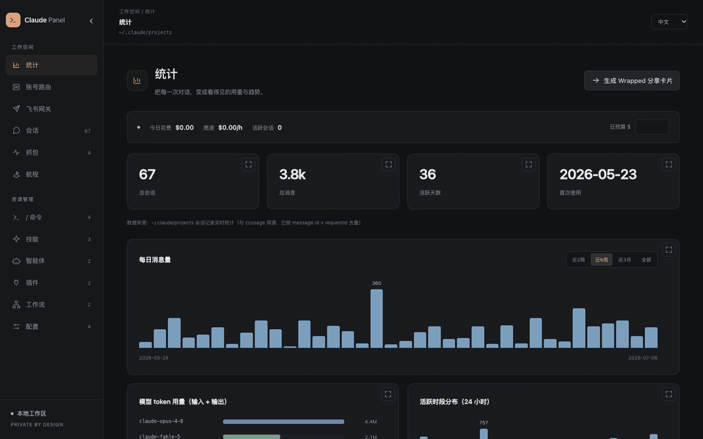

## 为什么做这个

Claude Code 把东西散落在 `~/.claude` 各处——命令一处、技能一处、插件藏在 JSON 清单里、用量埋在几百 MB 的会话记录里。而最有价值的东西——**到底发给大模型了什么**——根本没存。Claude Panel 两个都解决:

- **查得快**:命令 / 技能 / 插件 / 历史会话不用在命令行里翻,一屏可搜、可直接编辑。
- **找得回**:电脑卡死 / 重启后丢掉的那个会话,全文搜索历史内容,一键 `claude --resume`。
- **看得透**:一条回复是怎么来的——精确的**系统提示词**、**工具定义**、**完整上下文**,以及这条提问触发了**几轮 LLM 调用、每轮的输入和输出**。

## 杀手级功能:看到每一轮 LLM 调用

Claude Code 的会话记录里没有系统提示词、也没有原始请求/响应。Claude Panel 起了一层**本地正向代理**,让 CC 的流量从这里走,记录每次 API 调用,再按轮次精确折叠回会话回放里。

打开一个会话、展开某条提问,就出现 **「🔁 这条提问触发了 N 轮 LLM 调用」**。展开任意一轮,能看到这一轮**发给大模型的完整上下文**(每条消息、工具调用、工具返回)、**系统提示词**、**工具定义(含完整描述)**、**思考过程**、**响应**,以及 token 用量。

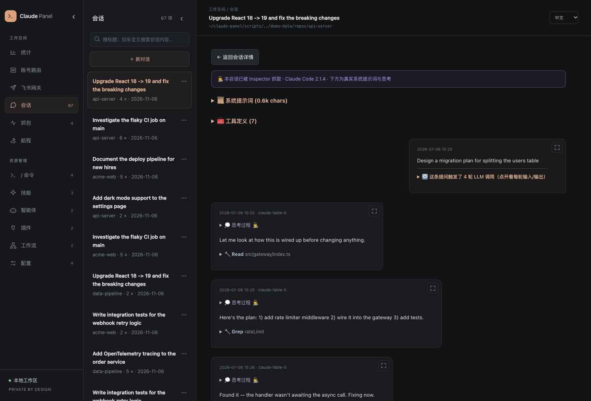

一次配置即可——面板首次启动会自动把一个智能 `claude` 包装函数写进你的 shell(面板开着就走代理、关了自动直连,永不影响正常使用)。凭证不会写入抓包记录，数据只保存在本机。多账号路由使用显式的本地代理配置，需保持面板运行。

## 🚢 你的会话就是一段航程

几百个会话不是乱账——它是你工作的航海日志。**航程**专区把它们渲染成一条连续的时间线:按项目着色的时间之河(色块=会话,高度=对话轮数),以及一段段"航段"——每段连续作业都以你出发时的那句意图命名。全部本地,来自 `history.jsonl`。

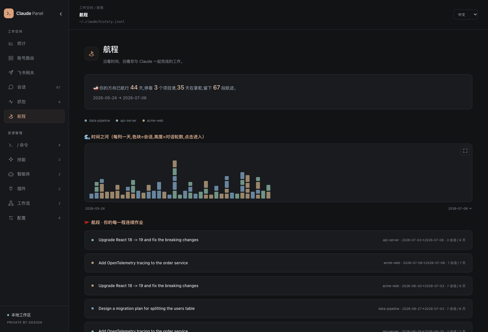

## 功能

| 专区 | 内容 |
|---|---|
| **/ 命令** | 自建 + 插件提供 + CC 内置命令统一列表,带使用次数;自建可增删改,内置只读 |
| **技能 / 智能体 / 工作流** | 浏览编辑,frontmatter 变标签,Markdown 渲染;市场安装项自动识别、防误改 |
| **插件** | 已装插件的版本/市场/提供的能力,一键卸载 |
| **配置** | `CLAUDE.md`、`settings.json`、快捷键就地编辑(JSON 保存前校验),含 CLAUDE.md 合并视图 |
| **多账号路由** | 一键接入当前 Claude 配置；优先粘贴完整 env 自动识别，附带示例；支持账号切换、自动故障转移、轮询、模型映射和额外环境变量 |
| **会话** | 仍有记录的全部会话——跨会话全文搜索、聊天式**回放**、一键 `claude --resume` |
| **🕵️ 抓包 Inspector** | 本地正向代理实时抓取:系统提示词、工具定义、完整上下文、含思考的流式响应、CC 版本;持久化到本地,折叠进回放 |
| **统计** | 与 `ccusage` 对齐的用量:每日消息、模型 token、24h 热区、`ccusage daily` 同款费用表,以及实时条(今日花费/燃速/预算告警) |
| **🚢 航程 Voyage** | 把散乱的会话重织成一条时间线——按项目着色的"时间之河"(高度=对话轮数),切分成一段段"航段",每段以你出发时的意图命名。看清方舟怎么驾驶、走向何处 |
| **🎁 Wrapped** | 一键生成可分享 PNG 成绩单:花费、token、最爱命令、本命模型、专属称号 |

横向能力:

- 🌏 **完整多语言** —— 中文 / English / 日本語 实时切换(界面 + 后端 + 生成内容)
- 📁 **项目作用域** —— 下拉框把命令/技能/智能体/工作流/配置切到任意项目的 `.claude/`
- 🎯 **统计准确** —— 递归扫描、`message.id + requestId` 去重、流式取终值、区分 5m/1h 缓存价,与 ccusage 逐日校验一致
- 🔒 **只在本机** —— 仅监听 `127.0.0.1`,防目录穿越,凭证不写入抓包
- ⚡ **零依赖** —— 无构建步骤,300MB 会话记录冷扫 ~0.8s(热 ~13ms)

## 快速开始

需要 Node.js ≥ 18。

```bash
npx claude-code-panel
# 打开 http://localhost:4321
```

首次运行会把 `claude` 包装函数写进你的 shell,之后的会话自动被抓取。**开一个新终端**(或 `source ~/.zshrc`),照常用 `claude`——面板开着时,那次会话的完整 trace 就会出现在「会话」里。不想自动接入设 `CCP_NO_PROXY_SETUP=1`;移除用 `npx claude-code-panel uninstall-proxy`。

从源码运行(零依赖,无需 `npm install`):

```bash
git clone https://github.com/13days/claude-panel.git
cd claude-panel && node server.js
```

环境变量:`PORT`(默认 `4321`)、`PROXY_PORT`(默认 `PORT+1`)、`CLAUDE_DIR`(默认 `~/.claude`)、`CCP_NO_PROXY_SETUP=1` 跳过 shell 接入。

### 多账号动态路由

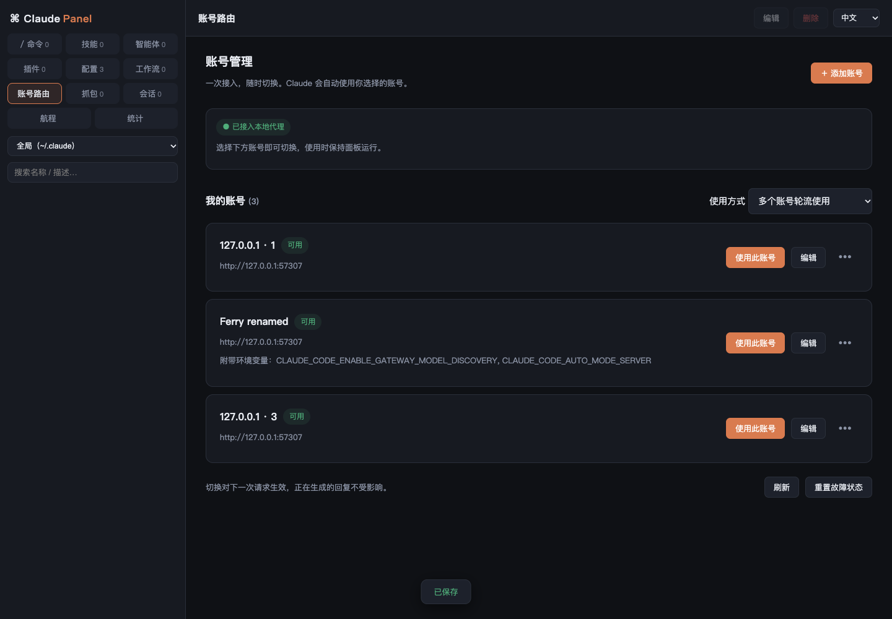

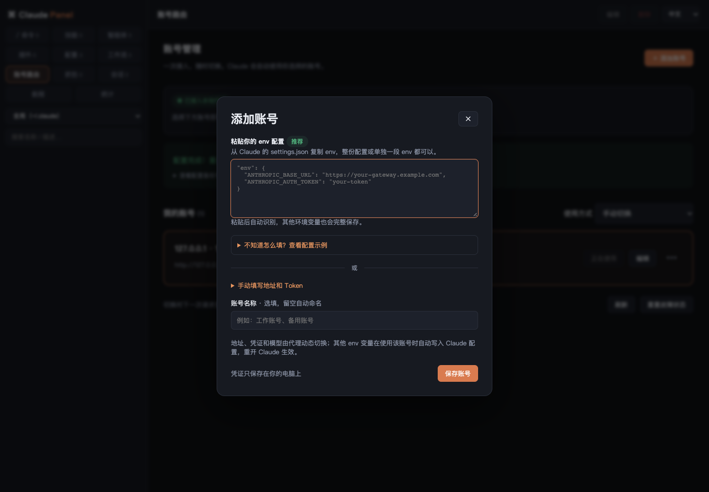

在「账号路由」页面添加多套 env，Claude Code 固定连接本地代理，由代理为每次请求选择账号。支持手动切换、按列表顺序故障转移、轮询、冷却管理，以及每个账号独立的模型映射；抓包列表同时显示实际使用的账号。

1. 启动面板，打开「账号路由」，点击「一键配置」。自动导入 Claude 当前 `settings.json` 中的账号、备份原文件，并将 Claude 接入本地代理，无需提前添加账号。重复点击不会重复导入或备份。
2. 点击「添加账号」，优先直接粘贴 env，自动识别后点击保存；支持整份 settings.json、`{"env":{...}}`、`"env": {...},` 片段及纯 env 对象。不知道如何填写时，可展开「查看配置示例」并一键填入 Ferry 示例。也可以在「或」下展开手动填写地址和 Token，名称选填。认证方式和模型映射在高级设置中按需展开。
3. 在账号卡片上点击「使用此账号」立即切换，也可选择自动故障转移或轮询。「更多操作」中可以停用、删除或调整优先级。Claude 的 base URL 使用 `http://127.0.0.1:4322`（默认端口），上游真实凭证由代理注入。
4. **首次接入需重开 Claude**。如果终端已导出 `ANTHROPIC_BASE_URL` / `ANTHROPIC_AUTH_TOKEN` / `ANTHROPIC_API_KEY`，先 `unset` 这些变量；项目 settings 或启动参数中也不要覆盖本地地址。之后页面上的切换从下一次请求起生效，无需再重开会话。已在生成的流式回复继续使用原账号。

自动策略遇到 401 / 402 / 403 / 429、500 / 502 / 503 / 504 / 529 或连接错误会尝试下一个可用账号。默认冷却分别为认证错误 300 秒、额度耗尽或限流 60 秒、服务错误 15 秒，并支持上游 `Retry-After`（最多一天）。全部账号冷却时返回 503，可在页面清除冷却或手动指定账号重试。其他请求错误原样返回，流式响应开始后不会重放。不同供应商对历史 thinking 签名的支持可能不同，代理会保留原始消息，不自动删除上下文。

模型映射填写 JSON，例如 `{"opus":"your-opus-id","sonnet":"your-sonnet-id"}`，或 `{"*":"fixed-model-id"}`。支持 Bearer 和 x-api-key 两种独立凭证；「透传客户端真实凭证」只适用于客户端持有真实账号凭证的场景，不能使用接入生成的本地占位 token，也不会模拟 OAuth 登录或刷新。

完整 env 会随账号保存，包括空字符串和额外变量（例如 `CLAUDE_CODE_ENABLE_GATEWAY_MODEL_DISCOVERY`、`CLAUDE_CODE_AUTO_MODE_SERVER`）。地址、凭证和模型由代理按请求切换；手动选择账号后，其余 env 会自动写入 Claude 的 settings.json，并提示重开 Claude 使进程环境生效。切走时会恢复原有值或移除该账号新增的变量。自动故障转移和轮询仅切换上游，客户端环境变量保持当前选择的账号配置。接口仅返回变量名称，不返回已保存的 env 值或凭证。

账号配置保存在 `CLAUDE_DIR/panel-proxy.json`，文件权限 `600`，上游 token 不通过账号管理接口返回，也不写入请求头抓包。凭证是本机明文文件，请妥善保管。接入前的备份位于同目录的 `settings.json.proxy-backup-*`；需要退出本地路由时，可以将备份里的原 env 合并回 `settings.json`，重启 Claude。**使用多账号路由期间必须保持面板进程运行**；显式指向本地代理的配置不支持面板关闭后自动直连。

### 终端状态栏

让 CC 终端底部实时显示今日花费——在 `~/.claude/settings.json`:

```json
{ "statusLine": { "type": "command", "command": "curl -s http://localhost:4321/api/statusline" } }
```

→ `$23.40 today · 40.6M tok · fable-5`

### 用演示数据先玩玩

```bash
python3 scripts/gen-demo-data.py
CLAUDE_DIR="$PWD/demo-data/claude" PORT=4999 node server.js
```

## 截图

**用量仪表盘** —— 实时花费条、每日消息量、模型 token、`ccusage daily` 同款费用表:

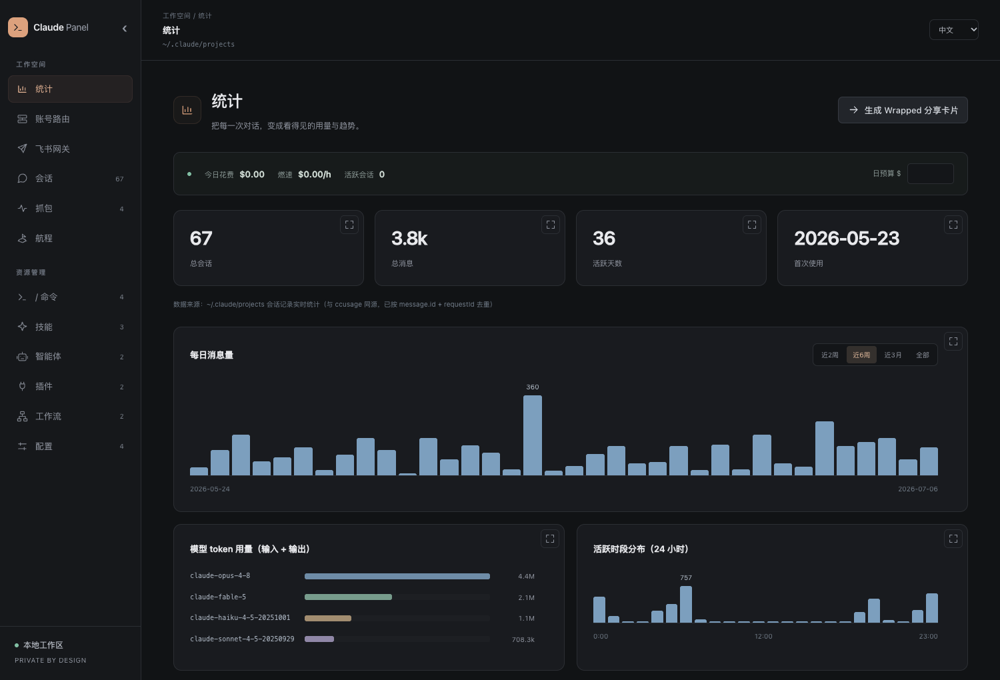

**抓包 Inspector** —— CC 从不保存的真实系统提示词、工具定义与响应:

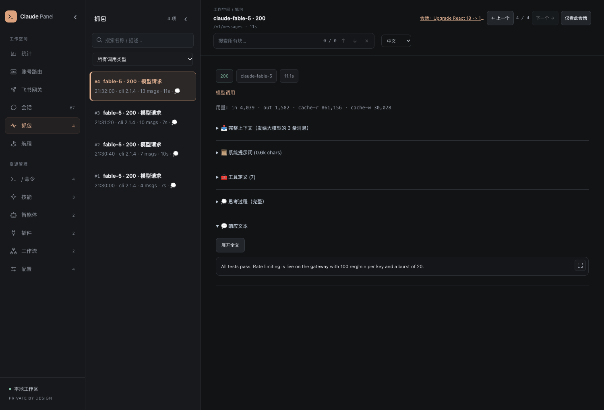

**所有命令一屏看全** —— 自建的、插件带的、CC 内置的,带使用次数:

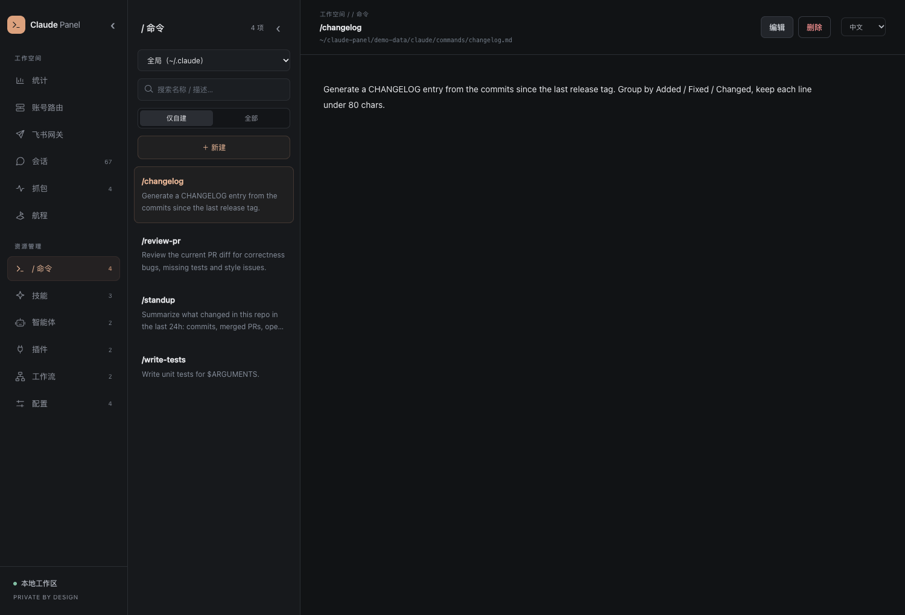

**技能认真渲染** · **🎁 Wrapped 卡片** · **说你的语言**:

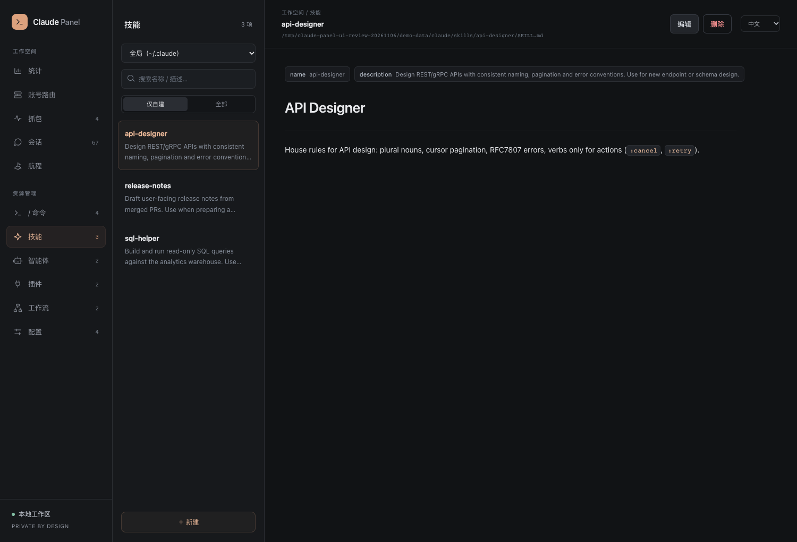 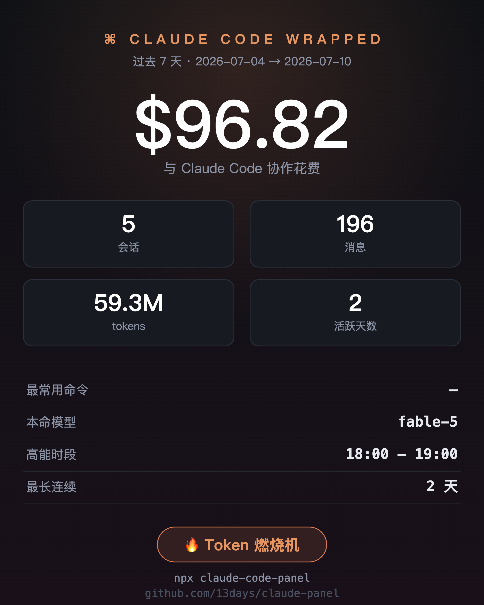

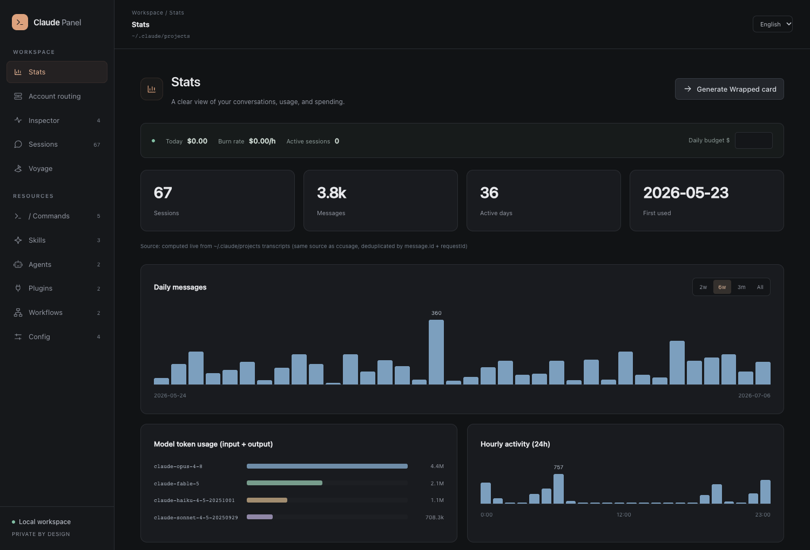

## 实现

无框架、无构建:

- **`server.js`** —— 零依赖 Node HTTP 服务:`CLAUDE_DIR` 上的 REST API(写操作有防护)、基于会话记录的用量聚合(mtime 缓存),以及 `PROXY_PORT` 上的正向代理——记录每次 `/v1/messages` 往返(解压 gzip/br),按响应 message id 关联。
- **`proxy-router.js`** —— 多账号配置持久化、动态路由、模型映射、故障转移和流式转发。
- **`index.html`** —— 单页应用,自带迷你 Markdown 渲染器和纯 CSS 图表。

### 新增语言

1. `index.html` 的 `LANGS` 注册(出现在下拉框)
2. `index.html` 的 `I18N` 和 `server.js` 的 `STRINGS` 各加一份字典

允许部分翻译,缺失 key 自动回退 `所选语言 → English → 默认`。

## 已知限制

- 费用为官方定价估算(与 ccusage 校验过,和账单可能有出入)
- CC 会话记录约保留 30 天;系统提示词 / LLM trace 只对**走过代理被抓取的会话**存在,历史会话补不回
- 内置命令清单是静态快照(欢迎 PR)

## 许可

[MIT](LICENSE)

---

*用 [Claude Code](https://claude.com/claude-code) 构建,为 Claude Code 服务。*

## 开发与验证

从源码执行：

```bash
npm test
```

测试使用本地模拟上游，覆盖账号切换、流式转发、故障转移、凭证隐藏、一键接入和完整 env 的保存与恢复，不调用真实模型 API。

## 0.15.0 更新

- 新增多账号动态路由：手动切换、自动故障转移、轮询与独立模型映射。
- 一键导入当前 Claude 账号、备份 settings.json 并接入本地代理。
- 粘贴 env 为首选添加方式，自动解析并提供 Ferry 示例；手动输入作为备选。
- 保存完整 env，选用账号时同步额外变量并提示重启，切走时恢复原值。
- 抓包记录显示实际使用的账号，新增浏览器标签页图标。
- 默认文档改为中文，英文文档保留在 [README.en.md](README.en.md)。
