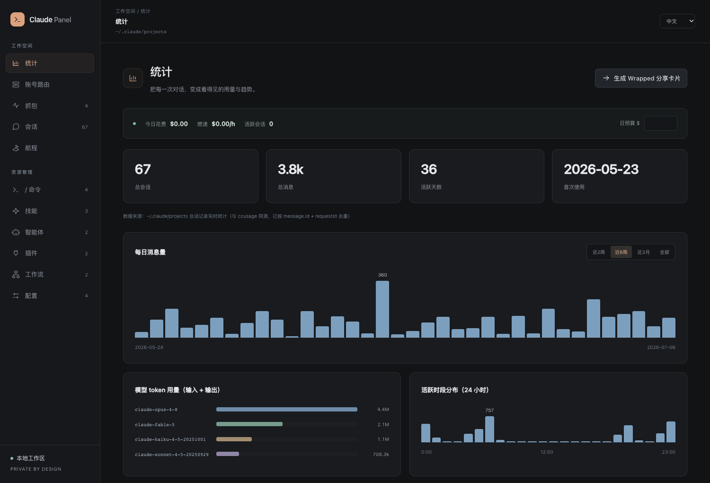
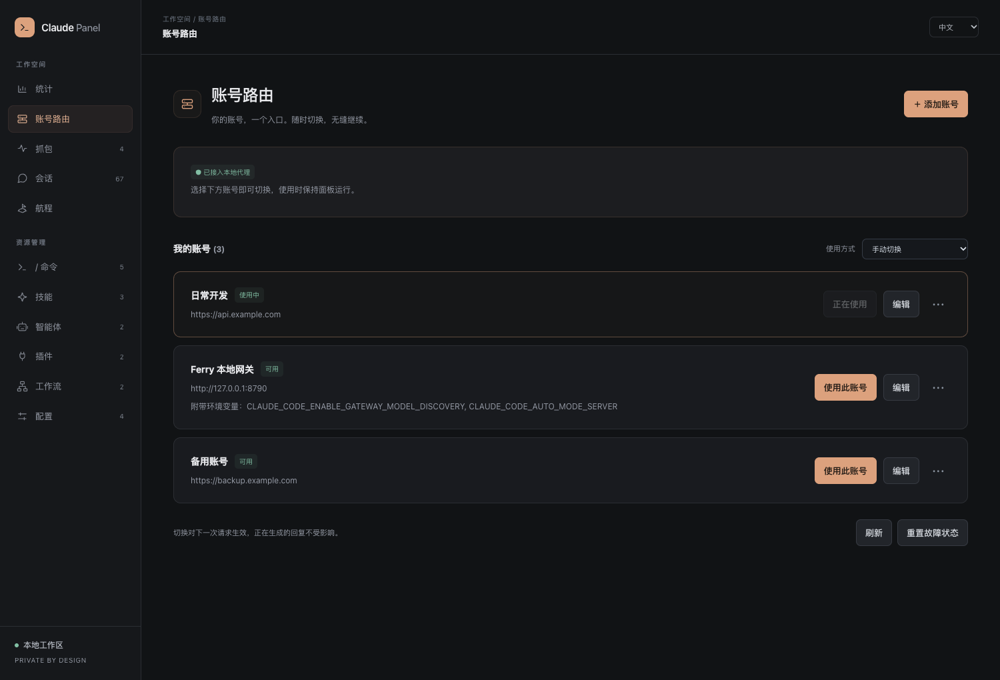
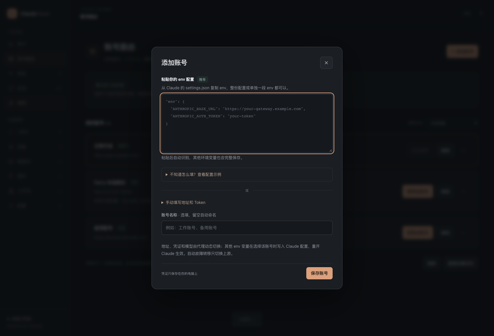
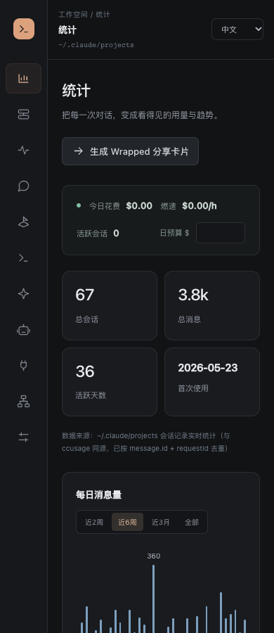

# 全站界面 Review · 0.15.1

本轮检查覆盖全部 11 个专区，以及新建、编辑、账号导入、会话回放和 Wrapped 弹窗。保留暗色工作台，统一暖色强调色、字体、间距、边框和控件层级，无新增运行依赖。

## 共性问题与修正

- 导航按钮和资源列表原先混在一栏，增加功能后难以定位。现分为分组导航、资源列表、内容区；统计、账号和航程隐藏无关资源列表。
- 页面之间的标题、字号、间距、卡片和按钮缺少一致规则。现由 `panel.css` 统一管理，只在主操作使用强调色。
- 路径和正文混在工具栏，禁用的编辑、删除按钮始终占位置。现区分专区、当前内容和路径，隐藏不可用操作。
- 部分空页面只有一句说明。现提供清晰的专区说明；首次打开且没有会话数据时，可直接进入账号配置。
- 小屏下多栏挤压内容。现将导航收为图标，资源列表用抽屉显示；正文、账号操作与统计卡片适应窄屏。
- 交互控件使用原生按钮与表单，统一键盘焦点、通知语义、导航标签，并支持减少动态效果的系统偏好。

## 逐页检查

| 页面 | 调整 |
|---|---|
| 统计 | 独立概览标题、统一指标卡片、图表网格、柔和的分类配色、费用条与范围选择器；增加首次使用引导 |
| 账号路由 | 统一标题与接入卡片，突出当前账号，次要操作收进菜单；保留粘贴 env 优先与配置示例 |
| 抓包 | 独立请求列表；请求状态、账号、模型和耗时集中展示；详情采用统一的可展开区域 |
| 会话 | 统一会话列表、详情表格与回放入口；回放中的用户消息、助手消息、思考和工具块有明确层级 |
| 航程 | 统一概览、时间之河、项目图例和航段卡片；从航段进入会话时同步导航状态 |
| 命令 | 独立资源栏、筛选分段、搜索空状态、统一详情与新建入口 |
| 技能 | 调整列表密度和元信息标签；统一 Markdown、代码、表格和编辑器样式 |
| 智能体 | 沿用资源页布局，统一描述、工具标签与文件操作 |
| 插件 | 统一只读详情与来源标签，隐藏不可用编辑操作，保留卸载入口 |
| 工作流 | 统一资源列表与代码详情、编辑器、新建弹窗 |
| 配置 | 统一作用域、配置列表、JSON 编辑器、保存 / 取消和导入 / 导出操作 |

## 同时发现并修复的交互问题

- 统计、账号或航程页残留上一页列表，误点后会把资源名写入总览标题。
- `setEditMode(false)` 会重新显示上一页的元信息，导致统计页出现无关技能标签。
- 页面快速切换时，较晚返回的资源、抓包或航程响应可能覆盖当前页面。
- 航程切换语言时错误调用统计渲染函数。
- 航程中进入会话未同步全局导航与页面布局。
- 编辑未保存时直接切换专区缺少确认。
- 抓包引导仍描述“只在内存保留 50 条”，与现有的本机持久化和最近 200 条展示不符。

## 验证

使用临时演示数据，与用户实际账号、会话、配置隔离：

- Chrome 检查全部 11 个专区，截图检查标题、列表、内容和控件。
- 在 1500、1024、768、390 像素宽度检查布局，无页面级横向溢出。
- 验证搜索与空状态、新建命令、编辑保存、未保存导航确认、JSON 编辑器、会话回放、抓包展开、Wrapped、语言切换、env 示例和移动资源抽屉。
- 16 项代理集成测试通过，浏览器无未捕获错误。
- npm 分发文件包含 `panel.css`，以打包后的 CLI 和样式端点进行安装验证。

